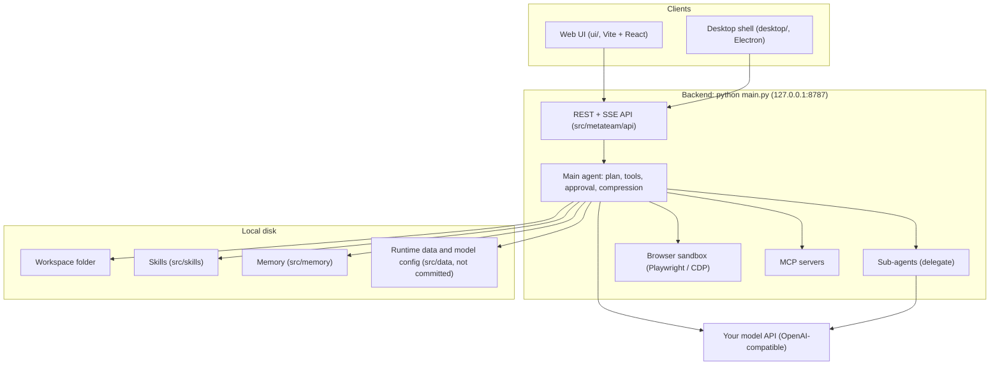

<p align="center">
  English | <a href="./README_CN.md">简体中文</a>
</p>

<p align="center">
  
</p>

<p align="center">
  <b>EdgeSidekick</b> — local-first multi-agent AI workbench for your own machine
</p>

<p align="center">
  <a href="https://gqqi.github.io/EdgeSidekick/">GitHub Pages</a> ·
  <a href="./LICENSE">MIT License</a>
</p>

<p align="center">
  
  
  
  
</p>

**EdgeSidekick** is an open-source **local multi-agent AI workbench**. Open a folder on your disk, chat in the browser or desktop shell, and let a main agent plus sub-agents search and edit files — with human approval, drop-in Skills, Memory that sticks, MCP tools, and a browser sandbox.

Built to be **forked** (clear Python + Vite layers) and **cheap to run** (context compression, on-demand Skills, separate main / sub / compress models).

**Windows · macOS · Linux** · default API **http://127.0.0.1:8787**

## Screenshots


More product pages and the bilingual marketing site live under [website/](./website/).

## Quick start

> Requirements:
>
> - Python **3.10+**
> - Node.js **18+** (UI / desktop build)
> - Optional: Playwright Chromium for the browser sandbox / agent browser tools

### Run the API + web UI

**Windows (PowerShell)**

```powershell
cd path\to\Sidekick
python -m pip install -r requirements.txt
python main.py
```

Or double-click **start.bat**.

**macOS / Linux**

```bash
cd /path/to/Sidekick
python3 -m pip install -r requirements.txt
python3 main.py
```

Open **http://127.0.0.1:8787** → pick a workspace folder → Settings → Model → API key.

### Offline demo without an API key

`scripts/mock_llm.py` is an OpenAI-compatible offline demo model that understands the Social-mode planner and member prompts, so you can try the full group collaboration flow without a key (for real use, configure your own model in Settings → Model):

```bash
python scripts/mock_llm.py --port 18931
SIDEKICK_DATA_DIR=/tmp/sidekick-demo META_PORT=18787 \
OPENAI_API_KEY=mock OPENAI_BASE_URL=http://127.0.0.1:18931/v1 OPENAI_MODEL=mock-team \
python main.py
```

Then open http://127.0.0.1:18787. After changing the UI, rebuild it with `cd ui && npm install && npm run build`.

If you save a model in Settings → Model, that account uses it instead of the environment variables. Leaving its API key empty switches to Demo mode, where every member only replies "【Demo 模式】…"; when pointing at the mock model, any key (e.g. `mock`) works.

### Tests

```bash
python -m pytest tests -q                 # plugin system
cd ui && npm test && npm run typecheck    # Social-mode orchestration and other UI logic
```

### Desktop app

```powershell
.\start-desktop.bat
```

Creates a project-local .venv, installs Python + Playwright Chromium if needed, builds the UI, and launches Electron with a live embedded browser preview.

See [desktop/README.md](./desktop/README.md) and [docs/browser-sandbox.md](./docs/browser-sandbox.md).

### Offline installers

- **Windows:** .\scripts\build-windows.bat → desktop/dist/EdgeSidekick-Setup-<version>-win-x64.exe — [packaging/windows/README.md](./packaging/windows/README.md)
- **Kylin / Linux:** bash scripts/build-kylin.sh → .deb / AppImage / tar.gz — [packaging/kylin/README.md](./packaging/kylin/README.md)

Installed app data defaults to %APPDATA%\EdgeSidekick\ (Windows) or ~/.config/EdgeSidekick/ (Linux).

> Never commit real API keys, .env, chat sessions, or model.json (see .gitignore).

### Local security (defaults)

- Binds **127.0.0.1** only; non-loopback bind requires META_ALLOW_REMOTE=1 (unsafe).
- Local token auth (X-Sidekick-Token); UI bootstraps via /api/bootstrap.
- Model API keys encrypted at rest under the local data dir.
- Shell tools go through the agent **approval gate** (disable with META_ALLOW_SHELL=0).

## Key features

**1. Workbench**  
Streaming chat (SSE), attachments, stop / edit-resend, content search, and a detail panel tied to your workspace files.

**2. Social mode with multi-agent collaboration**  
Every group message is first planned by your main model: one member answers, members split work in parallel, hand off in a pipeline, or discuss from different angles — each with a concrete task and deliverable, plus review and a final synthesis when useful. A plan card shows who does what; failures are reassigned and explained so someone always answers. See [docs/multi-agent-collaboration.md](./docs/multi-agent-collaboration.md) (Chinese).

**3. Browser sandbox**  
Desktop: live Electron BrowserView. Web: Playwright-backed preview. Select Mode sends DOM picks to the agent; agents can use browser_* tools.

**4. Skills**  
Drop skill packs under src/skills/ (or tenant skill dirs) and invoke with /skill <name>. Book → Skill can distill PDF/EPUB offline — see [docs/book-to-skill.md](./docs/book-to-skill.md).

**5. Desktop shell**  
One-click Electron app with embedded preview, packaging for Windows and Kylin/Linux, no cloud account required to run locally.

**6. MCP**  
Discover and connect Model Context Protocol servers from Settings → MCP (META_MCP_ENABLED=1).

**7. Plugin marketplace (GitHub / GitLab / Gmail …)**  
Install third-party plugin packages from Settings → Plugins (built-in marketplace, zip upload, URL, or your own marketplace index). Plugins run in a separate process, credentials are encrypted at rest, and write actions ask for confirmation. Package format: [docs/plugins.md](./docs/plugins.md) (Chinese).

**8. Light / dark + bilingual UI**  
Chinese / English interface and light / dark themes (local preference keys).

**9. Local-first**  
History, Memory (MEMORY.md), workspaces, and configs stay on disk you control. Bring your own model API (OpenAI-compatible, DeepSeek, Ollama, etc.).

### Slash commands

/help · /new · /clear · /skills · /skill <name> · /memory · /history · /browser · /stop

## Using EdgeSidekick

- **From source** — follow [Quick start](#quick-start).
- **Desktop** — start-desktop.bat or packaged installers under desktop/dist/.
- **Website & handbook** — [GitHub Pages](https://gqqi.github.io/EdgeSidekick/), [User guide (EN)](https://gqqi.github.io/EdgeSidekick/docs/user-guide.en.html) / [中文手册](https://gqqi.github.io/EdgeSidekick/docs/user-guide.zh.html).
- **Docs** — [docs/multi-agent-collaboration.md](./docs/multi-agent-collaboration.md), [docs/plugins.md](./docs/plugins.md), [docs/browser-sandbox.md](./docs/browser-sandbox.md), [docs/book-to-skill.md](./docs/book-to-skill.md).

## Architecture (short)



## Contributing

Contributions of all kinds are welcome:

- **Code / docs** — read [CONTRIBUTING.md](./CONTRIBUTING.md).
- **Ideas** — GitHub Discussions (placeholder until the public repo is live).
- **Translations** — keep README.md (EN) and README_CN.md (中文) in sync for short user-facing copy.

## Community

Placeholders until channels are published:

- GitHub Discussions — Q&A and ideas
- GitHub Issues — reproducible bugs
- Discord / chat — real-time help (link TBD)
- X / social — release notes (handle TBD)

## Security disclosure

Please report vulnerabilities privately per [SECURITY.md](./SECURITY.md). Do not post exploits in public issues.

## License

EdgeSidekick is released under the [MIT License](LICENSE).

---

**Product name:** EdgeSidekick · **Default bind:** 127.0.0.1:8787
