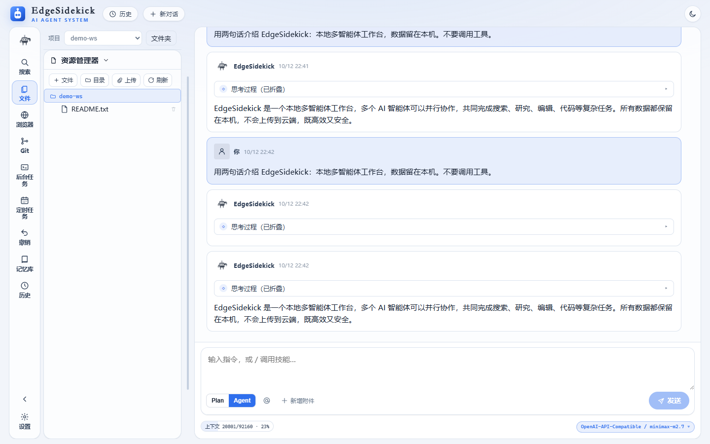
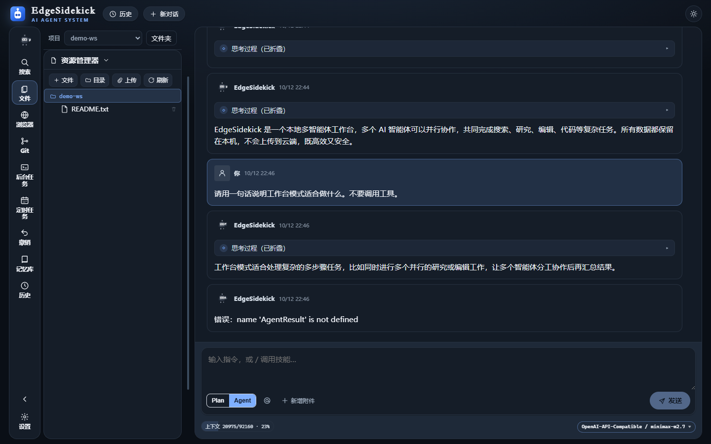
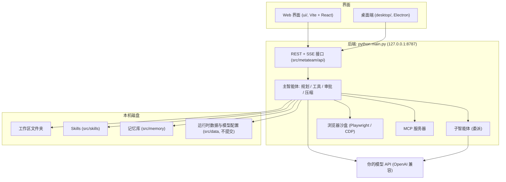

<p align="center">
  <a href="./README.md">English</a> | 简体中文
</p>

<p align="center">
  
</p>

<p align="center">
  <b>EdgeSidekick</b> — 本机优先的多智能体 AI 工作台
</p>

<p align="center">
  <a href="./website/index.html">官网（本地）</a> ·
  <a href="https://gqqi.github.io/SideKick/">GitHub Pages</a> ·
  <a href="./website/docs/user-guide.zh.html">使用手册</a> ·
  <a href="./LICENSE">MIT 许可证</a>
</p>

<p align="center">
  
  
  
  
</p>

**EdgeSidekick** 是开源的**本机多智能体 AI 工作台**。打开本机文件夹，在浏览器或桌面端对话，由主智能体与子智能体协作搜索、编辑文件——变更需你确认；支持可丢入的 Skills、长期 Memory、MCP 工具，以及浏览器沙盒。

为**二开**而设计（Python + Vite 分层清楚），也为**省 Token**而设计（上下文压缩、Skills 按需调用、主 / 子 / 压缩模型可拆开配置）。

**Windows · macOS · Linux** · 默认 API **http://127.0.0.1:8787**

## 界面预览





更多产品页与双语营销站见 [website/](./website/)。

## 快速开始

> 环境要求：
>
> - Python **3.10+**
> - Node.js **18+**（构建 UI / 桌面端）
> - 可选：Playwright Chromium（浏览器沙盒 / Agent 浏览器工具）

### 启动 API + Web UI

**Windows（PowerShell）**

```powershell
cd path\to\Sidekick
python -m pip install -r requirements.txt
python main.py
```

或双击 **start.bat**。

**macOS / Linux**

```bash
cd /path/to/Sidekick
python3 -m pip install -r requirements.txt
python3 main.py
```

打开 **http://127.0.0.1:8787** → 选择工作区文件夹 → 设置 → 模型 → API Key。

### 桌面应用

```powershell
.\start-desktop.bat
```

自动创建项目内 .venv、按需安装 Python 依赖与 Playwright Chromium、构建 UI，并启动带实时内嵌浏览器预览的 Electron。

详见 [desktop/README.md](./desktop/README.md)、[docs/browser-sandbox.md](./docs/browser-sandbox.md)。

### 离线安装包

- **Windows：** .\scripts\build-windows.bat → desktop/dist/EdgeSidekick-Setup-<version>-win-x64.exe — [packaging/windows/README.md](./packaging/windows/README.md)
- **麒麟 / Linux：** bash scripts/build-kylin.sh → .deb / AppImage / tar.gz — [packaging/kylin/README.md](./packaging/kylin/README.md)

安装后数据默认在 %APPDATA%\EdgeSidekick\（Windows）或 ~/.config/EdgeSidekick/（Linux）。

> 切勿提交真实 API Key、.env、会话或 model.json（见 .gitignore）。

### 本机安全（默认）

- 仅绑定 **127.0.0.1**；非本机绑定需显式 META_ALLOW_REMOTE=1（不安全）。
- 本地令牌鉴权（X-Sidekick-Token）；UI 经 /api/bootstrap 自动获取。
- 模型 API Key 在本地数据目录加密存储。
- Shell 工具仍走 Agent **审批门**（可用 META_ALLOW_SHELL=0 关闭）。

## 核心能力

**1. 工作台（Workbench）**  
SSE 流式对话、附件、停止 / 编辑重发、内容搜索，以及与工作区文件联动的详情面板。

**2. 会话版（Social mode）**  
面向会话的聊天布局，与经典工作台共用同一本地运行时。

**3. 浏览器沙盒**  
桌面端：Electron BrowserView 实况预览。Web：Playwright 预览。Select Mode 可将 DOM 点选发给 Agent；Agent 可使用 browser_* 工具。

**4. Skills**  
将技能包放入 src/skills/（或租户技能目录），用 /skill <名称> 调用。Book → Skill 可将 PDF/EPUB 离线蒸馏为技能 — 见 [docs/book-to-skill.md](./docs/book-to-skill.md)。

**5. 桌面端**  
一键 Electron 应用、内嵌预览，提供 Windows 与麒麟/Linux 打包；本地运行无需云账号。

**6. MCP**  
在「设置 → MCP」发现并连接 Model Context Protocol 服务器（META_MCP_ENABLED=1）。

**7. 浅色 / 深色 + 中英界面**  
中 / 英界面与浅 / 深色主题（偏好保存在本机）。

**8. 本地优先（Local-first）**  
历史、Memory（MEMORY.md）、工作区与配置均在你控制的磁盘上。自备模型 API（OpenAI 兼容、DeepSeek、Ollama 等）。

### 斜杠命令

/help · /new · /clear · /skills · /skill <名称> · /memory · /history · /browser · /stop

## 使用方式

- **源码运行** — 见[快速开始](#快速开始)。
- **桌面端** — start-desktop.bat 或 desktop/dist/ 下的安装包。
- **官网与手册** — [website/index.html](./website/index.html)、[website/docs/user-guide.zh.html](./website/docs/user-guide.zh.html) / [user-guide.en.html](./website/docs/user-guide.en.html)。
- **文档** — [docs/browser-sandbox.md](./docs/browser-sandbox.md)、[docs/book-to-skill.md](./docs/book-to-skill.md)。

## 架构（简）



## 参与贡献

欢迎各类贡献：

- **代码 / 文档** — 阅读 [CONTRIBUTING.md](./CONTRIBUTING.md)。
- **想法** — GitHub Discussions（公开仓库上线后启用，当前为占位）。
- **翻译** — 请保持 README.md（英文）与 README_CN.md（中文）短文案同步。

## 社区

以下渠道待正式发布后填写：

- GitHub Discussions — 提问与想法
- GitHub Issues — 可复现缺陷
- Discord / 聊天群 — 实时交流（链接待定）
- X / 社交账号 — 版本动态（账号待定）

## 安全披露

请按 [SECURITY.md](./SECURITY.md) **私下**报告漏洞，勿在公开 Issue 中贴利用细节。

## 许可证

EdgeSidekick 采用 [MIT 许可证](LICENSE) 发布。

---

**产品名：** EdgeSidekick · **默认绑定：** 127.0.0.1:8787
